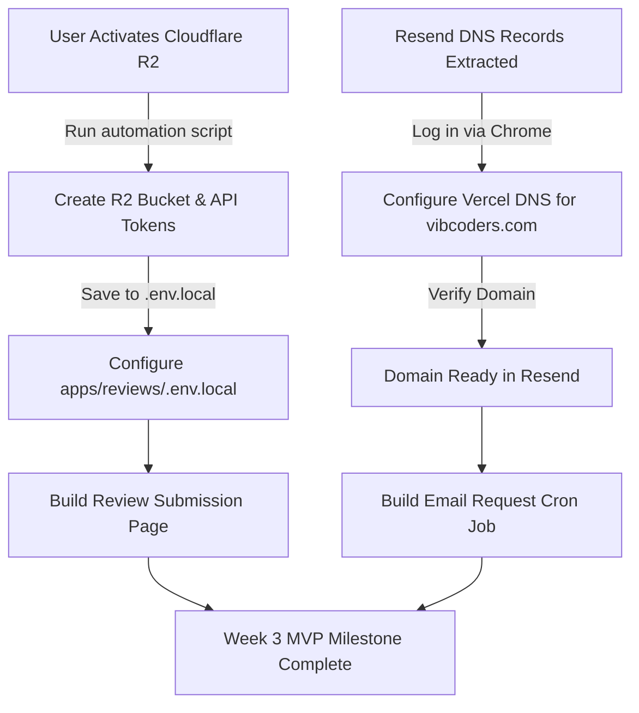

# Progress & Action Plan — Wix Reviews App

This document tracks completed tasks, the current state of our infrastructure, and detailed suggestions for what to build next and why.

---

## 🚀 What We Have Done So Far

We have laid down a secure, scalable foundation for the Wix Reviews App (`apps/reviews/`) following the Week 1 and Week 2 milestones.

### 1. Database & Token Encryption (Week 1–2)
* **AES-256-GCM Cryptography**: Secured OAuth access/refresh tokens at rest using a 32-byte master key (`WIX_TOKENS_MASTER_KEY`).
* **Schema & Migration**: Migrated Neon Postgres with encrypted credentials columns in the `accounts` table.
* **Auto-Refreshing Wix Client**: Built `getWixClient` to automatically decrypt tokens, instantiate the Wix SDK client, and hook into credentials-refresh events to re-encrypt and persist tokens back to the DB.
* **Tests**: Verified cryptography and database queries via automated integration test scripts (`scratch/test-crypto.js`).

### 2. Webhook Order Fulfilled Processing Pipeline (Week 2)
* **Background Processing**: Handled `wix.ecom.v1.order#fulfilled` webhook and integrated Next.js 15's native `after()` API to respond immediately to Wix in `< 10ms` while executing the payload in the background.
* **Review Request Scheduling**: Fetches order items and customer data from Wix API, and inserts a scheduled review request record into the database (defaulting to 14 days out).
* **Idempotency**: Prevents double-scheduling via database unique constraints on Wix Order IDs.
* **Tests**: Successfully verified the end-to-end webhook-to-database pipeline (`scratch/test-integration.ts`).

### 3. Transactional Email Migration: Postmark ➔ Resend
* **Decision**: Swapped Postmark for Resend because Postmark does not accept domains without public registry registration (privacy-shielded domains).
* **Domain Configuration**: Registered the custom domain `vibcoders.com` on Resend.
* **Full DNS Records Extraction**: Captured the untruncated TXT, MX, and CNAME records required for Vercel and saved them in `scratch/dns_records_full.json`.
* **API Keys & Codebase Integration**:
  * Generated a production Resend API Key.
  * Replaced `postmark` NPM package with `resend` in `apps/reviews/package.json`.
  * Updated Next.js 15 configuration, environment validators (`apps/reviews/lib/env.ts`), `.env.example`, and `.env.local`.
* **Build Verification**: Clean typecheck and successful optimized production compilation (`pnpm build`).

### 4. Centralized Credentials Backup
* Saved all current credentials securely inside the user's local directory: `C:\Users\prabh\.gemini\antigravity\credentials\wix_portfolio_credentials.json` (gitignored).

---

## ⚡ Current Status & Blocker

* **Cloudflare R2 Payment Activation**: We initiated Cloudflare R2 setup, extracted the Account ID (`317dee6de38fec1303a16f7070187a15`), and opened the billing page. R2 is free up to 10GB/mo but requires a credit card on file to activate.
  * *Open page:* `https://dash.cloudflare.com/317dee6de38fec1303a16f7070187a15/r2/checkout/payment`

---

## 💡 Suggestions: What to Do Next & Why

Here is the prioritized action plan for the next stages of development.



### 1. Configure DNS on Vercel for `vibcoders.com`
* **Why**: Resend requires these DNS records (TXT/MX/CNAME) to be active before it permits sending transactional emails from `@vibcoders.com`. Since `vibcoders.com` is hosted on Vercel, we can add them to Vercel's DNS panel.
* **How**: We can automate navigating to Vercel in the active Chrome instance (using Google OAuth session already active) to add the extracted records.

### 2. Complete R2 Bucket Creation & Token Provisioning
* **Why**: The reviews widget needs a destination to upload customer photos and videos.
* **How**: Once the billing details are submitted on the open Cloudflare page, run the automation script:
  ```powershell
  python scratch/create_cf_resources.py
  ```
  This will create the `wix-reviews-media` bucket, provision an edit-level API Token, and save the credentials. We then merge the credentials into `apps/reviews/.env.local`.

### 3. Implement Week 3 MVP Milestones: Email Sender & Public Submission Form
* **Why**: Connects the scheduled `ReviewRequest` records in Postgres to Resend for sending, and allows customers to write reviews and upload media.
* **Components to Build**:
  1. **Review Request Cron (`/api/cron/send-requests`)**:
     * Runs every 5–10 minutes.
     * Queries the DB for scheduled requests that are due (`scheduled_for <= now() AND status = 'SCHEDULED'`).
     * Renders a clean email template (React Email or standard HTML) and sends it via Resend.
     * Updates the status of the request to `SENT` and records the timestamp.
  2. **Review Upload Signature Endpoint (`/api/public/review/upload-signature`)**:
     * Generates S3-compatible pre-signed URLs using `@aws-sdk/client-s3` pointing to Cloudflare R2.
     * Ensures the client browser can upload images and videos directly to R2 without exposing root credentials or overloading our serverless Next.js functions.
  3. **Review Submission Form Page (`/public/review/[token]`)**:
     * Form accessible via the unique token from the email (no login required for buyers).
     * Collects ratings (1-5 stars), text feedback, customer name/email.
     * Uploads media (up to 5 photos, 1 video) directly to R2 using the pre-signed URL.
     * Creates rows in the `reviews` and `review_media` tables, then marks the review request as `COMPLETED`.
